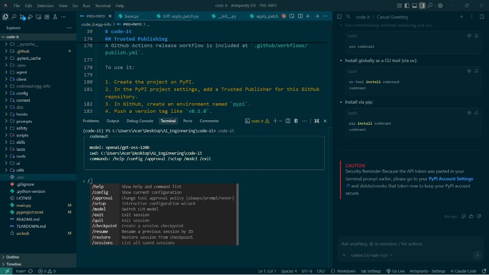

# codenaut

[](https://pypi.org/project/codenaut/)
[](https://www.python.org/downloads/)
[](LICENSE)
[](https://github.com/astral-sh/uv)

An autonomous terminal-based AI coding assistant that navigates, plans, edits, and executes code in your repository with tool calling, multi-file diff patching, file tagging, task management, and MCP support.

---



---

## Highlights

- 🚀 **`@` File Tagging & Autocompletion**: Type `@` anywhere in the prompt to search and tag files with dynamic dropdown suggestions. Tagged files automatically attach to your prompt context.
- ⚡ **Interactive Slash Commands**: Type `/` to get instantaneous popup completion for commands (`/help`, `/config`, `/approval`, `/setup`, `/model`, `/checkpoint`, etc.).
- 🛠️ **Multi-File Patching (`apply_patch`)**: Supports search/replace hunks, file creation, deletion, and renames across multiple files atomically.
- 📋 **Live Task & Checklist Engine**: Manages complex plans with `create_task` and `add_todo`, maintaining markdown checklists (`.tasks/*.md`) that update in real-time as subtasks complete.
- 🔌 **Model Context Protocol (MCP)**: Native support for connecting external MCP servers and tools.
- 🛡️ **Safety & Approvals**: Configurable approval policies (`always`, `prompt`, `never`) for dangerous tools, shell executions, and file deletions.
- 🧠 **Any OpenAI-Compatible Provider**: Works out of the box with OpenAI, OpenRouter, Groq, Ollama, vLLM, or any custom API endpoint.
- 💾 **Checkpoints & Persistence**: Snapshot, restore, save, and resume your coding sessions anytime.

---

## Installation

### Option 1: Using `uv` (Recommended)

Run directly on the fly without installing:
```bash
uvx codenaut
```

Or install globally as a persistent CLI tool:
```bash
uv tool install codenaut
codenaut
```

### Option 2: Using `pip`

```bash
pip install codenaut
codenaut
```

### Option 3: Using `pipx`

```bash
pipx install codenaut
codenaut
```

### Option 4: From Source (Development)

```bash
git clone https://github.com/nick211908/coding-agent.git
cd coding-agent
uv sync
uv run codenaut
```

---

## Getting Started

### 1. Configure Credentials

Configure your API key and provider URL:

```bash
codenaut --configure
```

You will be prompted for:
1. **API Key**: Your provider secret key (OpenAI, OpenRouter, Groq, etc.).
2. **Base URL**: Leave blank for default OpenAI, or enter your provider's URL (e.g. `https://openrouter.ai/api/v1` or `http://localhost:11434/v1`).

Credentials are securely stored in your user configuration directory:
* **Windows**: `%APPDATA%\codenaut\config.toml`
* **macOS**: `~/Library/Application Support/codenaut/config.toml`
* **Linux**: `~/.config/codenaut/config.toml`

*(You can also use a project `.env` file or `API_KEY` / `BASE_URL` environment variables).*

---

## Usage

### Interactive Mode

Start an interactive conversation in the current directory:
```bash
codenaut
```

Target a different project directory:
```bash
codenaut --cwd /path/to/project
```

### Single Prompt Mode

Run a single command or question non-interactively:
```bash
codenaut "Find and fix the failing test in tests/test_auth.py"
```

### File Tagging (`@`)

Tag one or more files anywhere in your message to inject their content directly into the conversation:
```text
> Can you compare @agent/agent.py with @main.py and refactor the loop?
```
As soon as you type `@`, a popup dropdown will suggest matching files from your repository.

---

## Interactive Slash Commands

Inside the interactive session, type `/` to access built-in commands:

| Command | Description |
| :--- | :--- |
| `/help` | Display command help and usage guide |
| `/config` | View active configuration and model parameters |
| `/approval` | Toggle approval policy (`always`, `prompt`, `never`) |
| `/setup` | Launch the credential configuration wizard |
| `/model` | Switch the active LLM model |
| `/checkpoint` | Save an instant snapshot of the current session state |
| `/restore` | Restore session state from a checkpoint ID |
| `/sessions` | List all saved past sessions |
| `/resume` | Resume a previous session by session ID |
| `/exit` or `/quit` | Exit the session |

---

## Project Customization

Customizations can be defined per-repository:

* **`AGENT.MD`**: Place an `AGENT.MD` file in your repository root (or subdirectories) to enforce project-specific coding standards, architectural rules, or instructions.
* **`.ai-agent/skills/`**: Add reusable skill folders containing `SKILL.md` to teach `codenaut` specific workflows.
* **`.ai-agent/tools/`**: Add custom Python tools discovered automatically at runtime.

---

## Development & Testing

Run unit tests:
```bash
uv run pytest tests
```

Build release packages:
```bash
uv build
```

---

## License

Distributed under the [MIT License](LICENSE).
